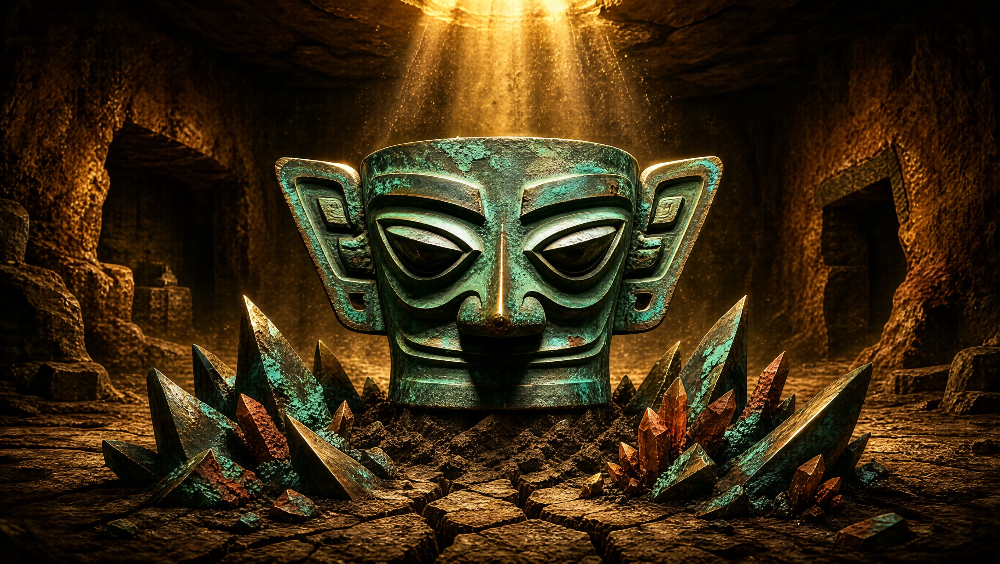
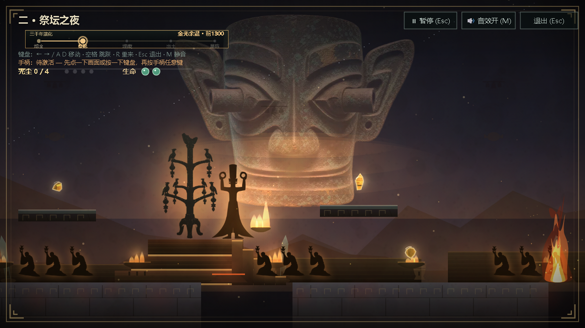
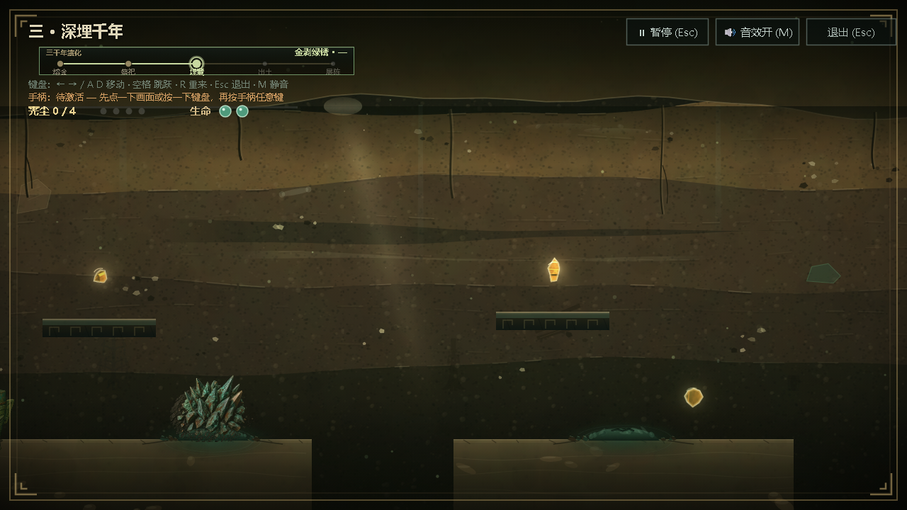
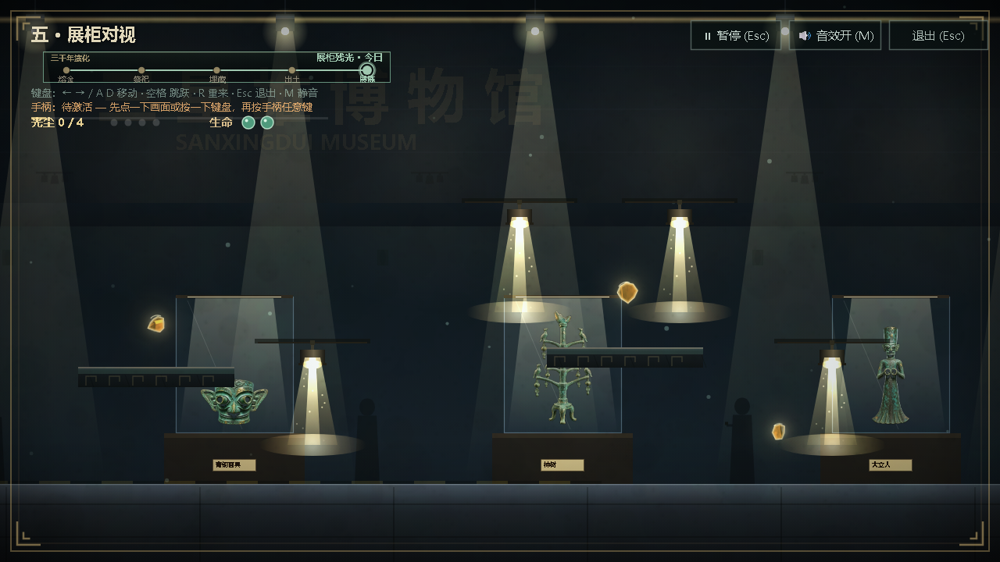
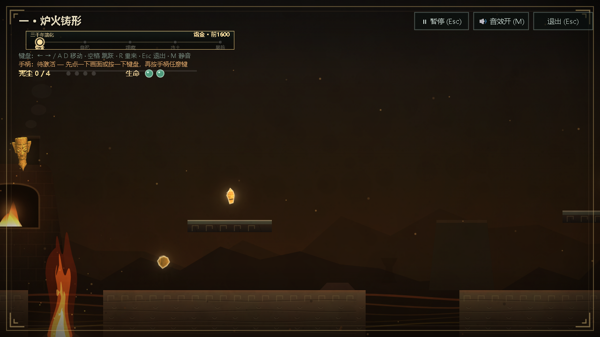
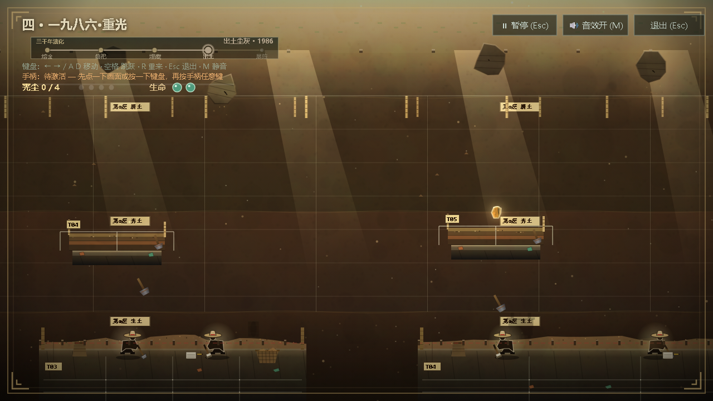
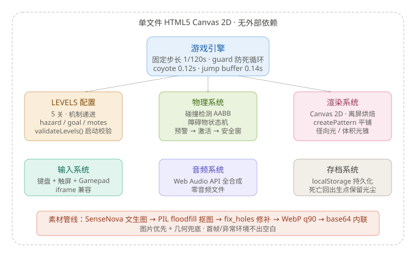
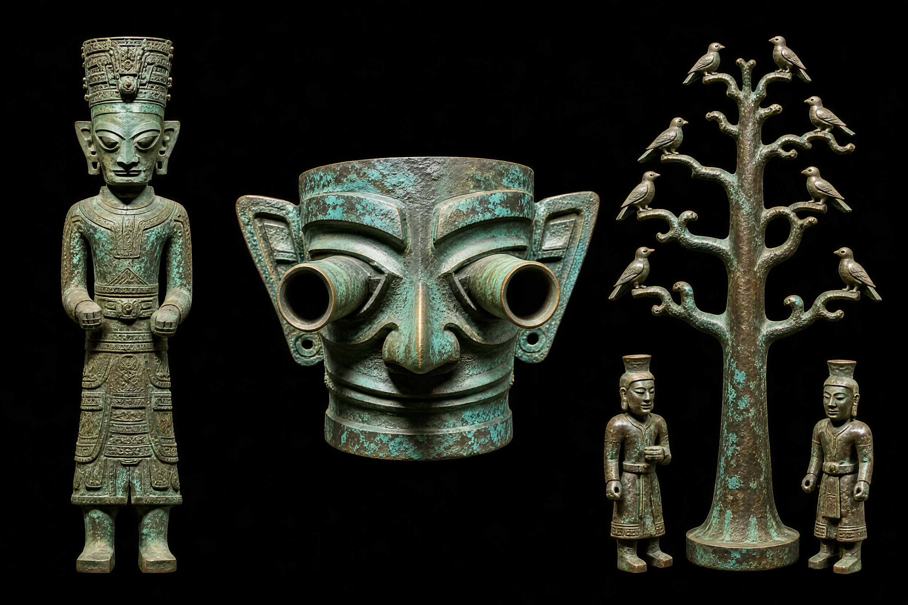
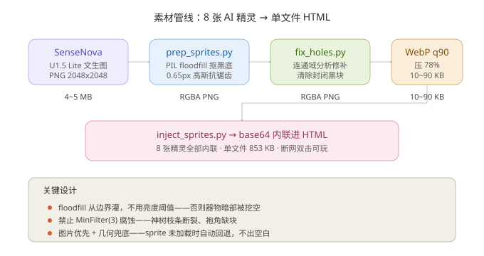
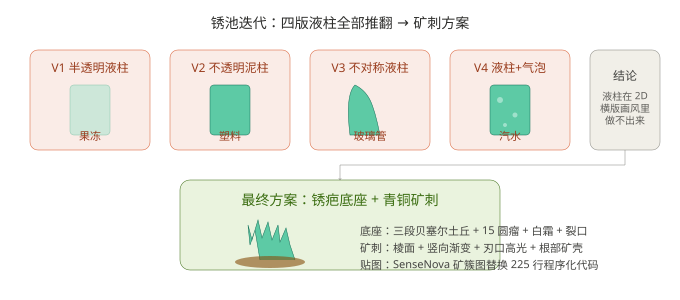

# 一个单文件 HTML5 Canvas 游戏，3 天从 72KB 做到 853KB：我和 AI 结对把三星堆青铜头像做成了 5 关横版闯关



> 项目地址：`https://xiangsir4088.github.io/sanxingdui-game/` ｜ GitHub：`https://github.com/xiangsir4088/sanxingdui-game` ｜ License：MIT
>
> **【开栏引言】** 这是「AI 结对实录」专栏的第二篇。上一篇写了 SignDock（Windows 托盘工具，Rust + Tauri 2），这篇写《一眼三千年》——三星堆祭司青铜头像 · Vibe Coding 游戏互动赛道参赛作品。同一个 AI（WorkBuddy 智能体），两套完全不同的技术栈：一个 Rust + WebView2 + SQLite，一个单文件 HTML5 Canvas 2D。方法论不变，踩坑完全不一样。

---

## 游戏介绍

《一眼三千年》是一个基于三星堆青铜头像的横版闯关游戏。玩家扮演一位时空旅人，从 3000 年前的铸铜炉膛出发，穿越祭祀祭祀、长埋地下的黑暗土层、考古发掘现场，最终抵达今天的博物馆展柜。

**5 关机制递进**：

| 关卡 | 名称 | 核心机制 | 氛围 |
|---|---|---|---|
| 第一关 | 铸铜炉膛 | 火喷柱（固定节奏） | 炉火映红的作坊 |
| 第二关 | 祭坛之夜 | 高台绕路 + 跪拜队列 | 星光下的祭祀仪式 |
| 第三关 | 长埋地下 | 锈池（从地缝喷出的铜锈矿刺） | 黑暗土层剖面 |
| 第四关 | 探方发掘 | 落石（从坑口坠落） | 考古工地 |
| 第五关 | 展柜对视 | 观众闪光灯（7 处爆闪） | 博物馆展厅 |

每关收集 4 缕「光尘」（青铜碎片的灵魂），集齐通关。HP 只有 2 点，死亡回到出生点但保留已收集的光尘。难度逐关递增——预警时间从 1.0 秒砍到 0.5 秒，安全窗从 1.6 秒砍到 0.8 秒。

**操作**：← → 移动，空格跳跃，R 重来，Esc 退出，M 静音。支持触屏虚拟键和手柄。











---

作为每天要用好几家 AI 产品的人，今年开始接三星堆博物馆的文化传播任务。博物馆给了一个素材——一张青铜头像的高清摄影图，要求做一个"Vibe Coding"交互作品：让公众能直接在线玩，不用下载任何东西。

于是有了 **《一眼三千年》**：一个单文件 HTML5 Canvas 2D 横版闯关游戏，没有任何外部依赖。所有素材（精灵图、文物图、音效、纹理）全部 base64 内联在 HTML 里，断网双击就能玩。3 天核心开发（10/24 初版 → 10/27 第八轮迭代），从 72 KB 做到 853 KB，5 关机制递进：火 → 高台绕路 → 锈池 → 落石 → 观众闪光灯。

这篇文章不讲游戏怎么玩，讲三件事：**① 几处机制级的设计决定（物理、渲染、素材管线）；② AI 写了什么、在哪翻的车、我怎么验收；③ 踩坑速查表**。

## 一、为什么选单文件 HTML5 Canvas 而不是 React + Three.js

三星堆博物馆的 Vibe Coding 赛道有一个硬约束：**参赛作品必须是单文件 HTML，无外部依赖，断网可跑**。这意味着：

| 维度 | 常见方案 | 本文方案 |
|---|---|---|
| 依赖 | React + Three.js + 音频库 ≈ 500KB | 零依赖 |
| 体积 | 3MB+（带 3D 模型和纹理） | 853 KB（含所有内联素材） |
| 加载 | 需要 CDN 或服务端 | 双击 `.html` 直接玩 |
| 素材 | 外部 PNG/MP3 文件 | 全部 base64 内联 |
| 部署 | 需要 Web 服务器 | GitHub Pages 单文件 |

技术选型：**HTML5 Canvas 2D + vanilla JS（无框架）**。整个游戏逻辑在一个 `<script>` 标签里，UI 用绝对定位的 div 叠在 canvas 上方。音频用 Web Audio API 全合成，零音频文件。

固定时间步 1/120 秒 + `guard` 计数器防死循环。coyote time 0.12 秒、jump buffer 0.14 秒——这两个参数是从横版游戏经典实现里抄的，不做的话跳跃手感会很差。

## 二、整体架构：5 关共用一套引擎



核心抽象是把「每关玩什么」收进 `LEVELS` 数组，引擎只认配置：

```javascript
const LEVELS = [
  {
    name: '铸铜炉膛',
    theme: 'forge',
    width: 2400,
    hazards: [
      { x: 400, y: 480, type: 'fire', interval: 2.0, warnTime: 1.0, activeTime: 0.95 },
      { x: 720, y: 480, type: 'fire', interval: 1.8, warnTime: 0.9, activeTime: 0.9 },
    ],
    goal: { x: 2300, y: 420 },
    motes: [
      { x: 500, y: 300 }, { x: 1000, y: 250 }, { x: 1500, y: 350 }, { x: 2000, y: 280 },
    ],
  },
  // ... 第 2~5 关
];
```

启动时 `validateLevels()` 做运行时校验：字段缺失、坐标越界、hazard 类型拼错——全部在加载时报错，不跑跑到游戏中途才炸。这是 P1.3 加的，之前一个拼写错误让第 3 关所有障碍物消失，跑了 20 秒才发现。

### 物理引擎：固定步长 + 防死循环

```javascript
const FIXED_DT = 1 / 120;
let accumulator = 0;

function update(dt) {
  accumulator += dt;
  let guard = 0;
  while (accumulator >= FIXED_DT && guard < 10) {
    step(FIXED_DT);
    accumulator -= FIXED_DT;
    guard++;
  }
  if (guard >= 10) accumulator = 0; // 防死循环
}
```

**为什么 1/120 而不是 1/60**：60fps 下每帧一步，如果某帧物理运算慢了（比如第 5 关机关每帧 10+ 层渐变），游戏帧率一掉就变成「时间暂停」——障碍物不动了，玩家跳不过去。1/120 给了物理循环 2 倍余量，渲染卡了物理照常走。

**为什么 `guard` 上限是 10**：120 步 / 60 帧 = 2 步/帧。如果某帧耗时 500ms，需要补 60 步才能追上来。`guard < 10` 意味着最多追 5 帧的物理，再多的直接丢弃——宁可画面卡顿，不让物理时间膨胀。

### 障碍物状态机：预警 → 激活 → 安全窗

```javascript
function stepHazards(dt) {
  for (const h of level.hazards) {
    if (h.active) {
      h.timer -= dt;
      h.cur = Math.min(h.hgt, h.cur + dt * 320); // 快速生长
      if (h.timer <= 0) {
        h.active = false;
        h.timer = h.interval;
        h.curVis = h.cur; // 记录视觉高度，用于消退动画
      }
    } else if (h.timer > h.interval - h.warnTime && !h.warned) {
      h.warned = true;
      h.warning = true;
    } else if (h.timer <= 0) {
      h.active = true;
      h.warning = false;
      h.warned = false;
      h.timer = h.activeTime;
    } else {
      h.timer -= dt;
    }
  }
}
```

节奏逐关收紧：第 1 关预警 1.0s / 亮 0.95s / 安全窗 1.6s；第 5 关预警 0.5s / 亮 1.05s / 安全窗 0.8s。**安全窗就是「两个障碍物之间的空白时间」**，玩家必须在安全窗内跳过去。从 1.6s 砍到 0.8s 意味着反应时间减半——这是玩家反馈里「越到后面越难」的核心机制。

## 三、素材管线：从 AI 文生图到内联 base64

这是本项目最复杂的工程链路。三星堆博物馆给了一张青铜头像摄影图（4.8 MB 参考图），AI 生成 8 张精灵（主祭、跪拜者、大立人、纵目面具、青铜神树、天空神面、锈贴图、矿簇图），全部需要处理成游戏可用的 sprite。



### 管线：SenseNova → PIL → WebP → base64



```
SenseNova U1.5 Lite 文生图
  ↓ (PNG, 2048x2048, 4~5MB)
prep_sprites.py (PIL floodfill 抠黑底)
  ↓ (RGBA PNG, 已抠图)
fix_holes.py (连通域修补封闭洞)
  ↓ (RGBA PNG, 无残留黑块)
WebP q90 压缩
  ↓ (WebP, 10~90KB)
inject_sprites.py (base64 内联进 HTML)
  ↓ (HTML, 单文件)
```

**关键设计：图片优先 + 几何兜底**。所有 AI 精灵都有对应的 Canvas 程序化绘制代码。sprite 加载成功就用图，否则走原几何绘制：

```javascript
const shard = SPR.rustShards;
if (shard && shard.complete && shard.naturalWidth > 0) {
  // 用 AI 生成的图
  ctx.drawImage(shard, cx - tgtW / 2, baseY - tgtH, tgtW, tgtH);
} else {
  // 兜底：程序化绘制简化版
  ctx.beginPath();
  // ... 3 根尖刺的几何绘制
}
```

### 抠图：floodfill 从边界灌，不用亮度阈值

AI 出图是纯黑底。第一版用亮度阈值抠图（`alpha = 255 - brightness`），结果**器物自身的暗部被一起挖空**——青铜面具的耳下阴影、立人的袍角都消失了。

改成 floodfill 从图像四角和四边中点灌入，只把「与边界连通的暗区」判为背景：

```python
seeds = [(0,0), (W-1,0), (0,H-1), (W-1,H-1),
         (W//2,0), (0,H//2), (W-1,H//2), (W//2,H-1)]
for sd in seeds:
    ImageDraw.floodfill(work, sd, 128, thresh=thresh)
alpha = np.where(arr == 128, 0, 255).astype(np.uint8)
```

**绝对不要加 `MinFilter(3)` 腐蚀**——第一版加了之后，青铜神树的细枝条被啃断、大立人的袍角缺块。腐蚀 1px 对细长结构是致命的。改成只用 0.65px 高斯模糊做抗锯齿。

### 封闭洞修补：floodfill 永远冲不到的背景

第三张图（青铜神树）处理后，放大一看——树枝之间残留纯黑方块。根因：floodfill 从图像边界灌入，**被主体围住的背景永远冲不到**。

`fix_holes.py` 做连通域分析：凡「不透明且 RGB≤8 且不与边界连通」的像素全部透明化，并把洞边缘一圈过暗像素 alpha 压到 96。三张展品精灵分别清除 72 / 229 / 41 个封闭域。

### WebP 压缩：426KB → 91KB

5 张 PNG 共 426 KB，base64 后 563 KB，HTML 会从 456 KB 涨到 1 MB+。转 WebP q90：426 KB → 91 KB（降 78%），base64 后约 121 KB。透明通道和质量都保住了。

## 四、锈池：从「果冻液柱」到「青铜矿簇」的八次重做

第 3 关「长埋地下」的核心障碍物是**锈池**——从地面裂缝中喷出的铜锈。这是整个项目迭代次数最多的元素。



### 四版液柱全部推翻

| 版本 | 形态 | 问题 |
|---|---|---|
| V1 | 半透明绿色液柱 | 果冻 |
| V2 | 不透明铜锈泥 | 塑料 |
| V3 | 轮廓不对称的液柱 | 玻璃管 |
| V4 | 液柱 + 气泡粒子 | 汽水 |

**结论：液柱这个形态在 2D 横版画风里做不出来。** 最终改成：常驻「锈疤」底座 + 一丛铜锈矿刺。


### 锈疤底座：地面上一坨常驻的铜锈结壳

侧视图里看不见地面顶面，任何往下的开口都会被读成「地面上一个浅碟 / 贴片」。所以底座必须有**体积**：

```javascript
// 主体：三段贝塞尔叠出的不规则土丘
ctx.beginPath();
ctx.moveTo(cx - h.w * 0.86, gy + 2);
ctx.bezierCurveTo(cx - h.w * 0.72, gy - scarH * 1.10,
                  cx - h.w * 0.30, gy - scarH * 1.28,
                  cx - h.w * 0.04, gy - scarH * 1.02);
ctx.bezierCurveTo(cx + h.w * 0.26, gy - scarH * 1.34,
                  cx + h.w * 0.66, gy - scarH * 1.06,
                  cx + h.w * 0.88, gy + 2);
ctx.closePath();
```

加 15 个圆瘤（随机分布的凸起）、6 片析出白霜、中央锯齿裂口（矿刺从缝里顶出来）、外侧 9 颗翻土块、向外放射的细裂纹。

### 程序化孔雀石纹理：环面 Voronoi + 域扭曲

单靠渐变填充，任何障碍物都是一块塑料。写了一个 Python 脚本烘焙可无缝平铺的 512×512 纹理：

```python
# 核心算法
# 1. 环面 Voronoi 细胞（矿瘤分布）
# 2. 域扭曲（让直线边界变弯）
# 3. FFT 高斯模糊（柔化细胞边界）
# 4. 同心环带（矿物层理）
# 5. 粉化区（随机白点）
```

输出 7 KB webp，以 `ctx.createPattern()` 叠加进矿刺。关键是**四边可接**——环面拓扑保证纹理在边缘无缝。

### 最终版：SenseNova 矿簇图替换 225 行程序化代码

3 天后陆队长额度恢复，直接出图：

- `rust_tex_v2.png`：氧化青铜孔雀石结晶壳 + 红棕铜腐蚀 + 蓝色铜绿纹路 + 深黑缝隙
- `rust_shards_v2.png`：纯黑底 + 尖角青铜孔雀石矿簇 + 底部散碎屑 + 深黑土壤基座

**225 行程序化几何体（6 根尖刺 × 11 层细节）→ 38 行 drawImage**。代码量减 83%，视觉质量大幅提升。

## 五、五道时代之门：为什么不能每关最后都进展柜

用户反馈原文：**「为何每一关最后都是进展柜」**。

确实——前 7 个版本五关共用同一扇门，玩家跑到终点看到展柜，以为「又进展柜了」。P2.1 把五关终点各用各的：
| 关卡 | 终点 | 设计意图 |
|---|---|---|
| 第 1 关 | 炉门 | 铸铜炉膛的出口 |
| 第 2 关 | 燎门柱头火盆 | 祭祀仪式的完成 |
| 第 3 关 | 地面裂口 | 长埋地下的穿越 |
| 第 4 关 | 探方竖井 | 考古发掘的发现 |
| 第 5 关 | 博物馆展柜 | 最终归宿 |

每个终点都有独立的动画：炉门有火舌舔舐、燎门有火盆跳动、地缝有深处透光、探方有天光照射、展柜有射灯和展签。**叙事上这是一个「从铸造到出土再到博物馆」的完整旅程，每关的门是对应的叙事节点**。

## 六、土层剖面：让第 3 关看起来「长埋地下」

用户反馈原文：**「第 3 关没有体现出深埋底下的感觉，画面也很粗糙」**。


原版只有四层同色正弦线。改成 4 层主土带（黄土→灰褐→深褐→青灰生土）+ 10 条断续沉积面 + 砂透镜 / 钙结核 + 炭黑层 + 红烧土层。

**关键教训：沉积层必须两端尖灭**。一条两端齐口的高对比色带会被读成「一块黑色横条」；沉积层必须**横向渐变淡出**，否则是贴纸。

**裂缝必须比环境更暗**。第一版裂缝内部比四周的土更亮，玩家读到的是「发光的土台」而不是「洞」。洞必须比环境更暗，只有缝口一线亮边 + 深处一点透光。

## 七、AI 协作实录：它写了什么，在哪翻的车，我怎么验收

这个项目是我和 AI（WorkBuddy 智能体）结对完成的，3 天 8 轮迭代。

**分工**。AI 写了：全部游戏逻辑（物理 / 渲染 / 碰撞 / 输入 / 存档）、5 关配置、所有 Canvas 绘制代码、音频合成、7 个 Python 构建脚本、截图验证工具、GitHub 发布自动化、CHANGELOG。人做：关卡设计拍板（节奏 / 难度 / 叙事）、用户反馈转译（把「太抽象」翻译成「用 SenseNova 出图」）、每轮验收（headless Chrome 截图逐像素检查）、素材提示词调优（每张图 2~3 轮才满意）、发布时机。诚实的占比：**AI 起草约 95%，人工全量 review**——但剩下 5% 是每一处「为什么」。

### 翻得最狠的一次：两层 era canvas 叠加显形亮方块

结局页想做「熔金 ↔ 绿锈」14 秒交叉淡化。结果两层一叠，主图周围浮出一个明显的浅色矩形。

根因：`getArtifactEraCanvas()` 烘焙的 canvas 是**整块矩形**——器物之外那圈海报底色被 `tint` 染色过，而边缘的径向淡出半径按 `max(AW, AH)` 算，覆盖不到矩形的左右边（中心到左右边只有 `AW/2`）。单层时和背景色接近看不出来，两层 alpha 相加就显形了。

试过让两层 alpha 之和恒定（0.98），没用——问题不在 alpha 总量，在于矩形内那圈染色底色本身。

**最终放弃双层方案**，改回单层 `forge`（原设计），只保留金箔粒子这个无副作用的部分。

教训：**不要试图用 alpha 混合解决结构性问题**。如果两个 canvas 的边界处理不同（一个有径向淡出，一个没有），alpha 调再对也会露馅。

### 更小但同类的翻车：同一绘制有两份代码

第 3 关锈池的底座画在 `if (h.cur > 8)` **之前**（每帧都画），喷发态又在里面重画了一遍。改代码时只改到里面那份，结果两份叠着画，怎么调都不对。

**改绘制前先搜同一套注释词，确认没有第二份。**

### 验收方法：三道闸

1. **`node --check` ≠ headless Chrome 截图 ≠ 真机跑**。JS 语法检查只管语法，headless 截图管渲染结果，真机跑管手感。三道闸各管一段。
2. **截图必须冻结 `tGlobal`**。周期性动画（落石、锈池、火焰）如果不冻结时间，每次截到的相位都不同，无法比对。`_shot.py` 注入 `__FREEZE` 钩子把 `tGlobal` 锁在固定值。
3. **像素覆盖率验证**。判断「画没画」不能用 PNG 体积差（几次改动只差几百字节），要算像素覆盖率。判断不了的中间状态，直接插桩：`window.__P1/P2/P3` 三个计数点，一次就能分清「没进循环 / 被 continue 掉 / 画了但看不见」。

### 上下文策略

四条，全部在用：

- **项目日志式 memory**：每个坑、每次失败、每个设计决定当天记档进 `.workbuddy/memory/`。跨会话开工先读日志——P2.6 开工时直接复用了 P2.5 的全部避坑记录（floodfill 不用腐蚀、封闭洞修补），零次试错。
- **注释即设计**：关键决策写成注释放在决策现场（「为什么不用腐蚀」「为什么洞必须比环境暗」「为什么两端必须尖灭」）。后续会话的 AI 读到注释就不会「好心」把它改坏。
- **铁律前置**：红线写进 MEMORY.md（「严禁凭历史记忆下结论」「禁止按行号删代码」），每轮会话自动注入。
- **先方案后动手**：大任务先让 AI 出计划，人确认再执行。不给整个需求让它自由发挥。

## 八、踩坑速查表

| 坑 | 现象 | 解法 |
|---|---|---|
| floodfill 加 `MinFilter(3)` | 神树枝条断裂、立人袍角缺块 | 去掉腐蚀，只用 0.65px 高斯模糊 |
| floodfill 从边界冲不到封闭背景 | 面具耳下、立人环握处残留纯黑块 | `fix_holes.py` 连通域分析，不接触边界的黑块全部透明化 |
| 两层 canvas 叠加显形亮方块 | 结局页浮出浅色矩形 | 放弃双层，回退单层 + 无副作用粒子 |
| 障碍物比可收集物更亮 | 锈池比金色光尘还亮，整屏最抢眼的是减速带 | 障碍物亮度上限 = 场景最亮可收集物 |
| 梯形光柱有硬边 | 读成「一块斜放的玻璃板」 | 改三段径向光叠加，边缘天然衰减 |
| 沉积层两端齐口 | 读成「一块黑色横条」 | 两端横向渐变淡出（尖灭） |
| 裂缝内部比四周更亮 | 读成「发光的土台」而不是洞 | 洞必须比环境更暗，只有缝口一线亮边 |
| 同一绘制有两份代码 | 改了一份另一份还在，怎么调都不对 | 改绘制前先搜同一套注释词，确认没有第二份 |
| `--virtual-time-budget` 等不到目标时刻 | `dt = min(raw, 0.05)` 卡死，`tGlobal` 涨不快 | 注入 `setInterval` 锁帧，或 `__FREEZE` 钩子 |
| headless 1280x720 第 5 关崩溃 | `Abnormal renderer termination` | 降分辨率到 960x540，或用 `--virtual-time-budget` |
| 矿簇图宽高比 1.29 vs 槽位 720×66 | 不能整张铺满 | 按 hazard 逐个绘制，每张 85 宽 × 66 高 |
| GitHub Pages CDN 缓存 | `/` 返回旧版，`/index.html` 返回新版 | SHA 校验一致即确认上传成功，CDN 延迟等几分钟 |

## 九、构建与发布

```bash
# 本地开发
open 一眼三千年.html  # 双击直接玩

# 生成素材
python assets/gen/prep_sprites.py   # AI 出图 → 抠图 → WebP
python assets/gen/fix_holes.py      # 修补封闭洞
python assets/gen/inject_sprites.py # base64 内联进 HTML

# 截图验证
python _shot.py                     # headless Chrome 逐关截图

# 发布到 GitHub Pages
python github-pages/_sync.py        # 增量同步（按 git blob sha 比对）
```

发布脚本用 GitHub Contents API，按 git blob SHA 逐文件比对，只上传变化的文件。中文图片路径自动改回 `poster.jpg`。

## 十、数字面板

| 项 | 值 |
|---|---|
| 核心开发周期 | 3 天（10/24 初版 → 10/27 第八轮） |
| 迭代轮次 | 8 轮（P0.x → P2.9） |
| 代码规模 | 约 8,400 行 JS / 853 KB 单文件 |
| 关卡数 | 5 关，机制递进 |
| 障碍物类型 | 4 种（火喷 / 锈池 / 落石 / 观众闪光） |
| AI 精灵 | 8 张（SenseNova U1.5 Lite 生成） |
| Python 构建脚本 | 7 个 |
| 踩坑记录 | 25+ 条（CHANGELOG） |
| AI 起草代码占比 | ≈95%（人工全量 review + 关卡设计 + 验收） |
| 体积增长 | 72 KB → 190 KB → 456 KB → 579 KB → 853 KB |

## 十一、已知可优化项

| 优先级 | 项 | 说明 |
|---|---|---|
| 中 | `drawHazards()` 每帧重建 50+ 个渐变对象 | 第 5 关机关 × 10+ 层，可预烘焙为 sprite |
| 中 | `drawPlayer()` 拖尾每帧 10 次 ellipse | 可合并为单次路径或 sprite |
| 低 | 存档无版本迁移逻辑 | `sdx_progress_v1` 加字段后老存档兼容性未处理 |
| 低 | 音量开关不持久化 | `audioMuted` 未写入 localStorage |
| 低 | 无难度选择 | 固定 `MAXHP=2`，通关玩家无更高挑战 |

## 结尾

《一眼三千年》8,400 行 JS、853 KB 单文件，单看都不算大。但把「三星堆青铜头像的 3000 年穿越旅程」用 5 关横版闯关表达清楚，靠的是那些**机制克制的设计决定**：固定步长防时间膨胀、guard 防死循环、节奏逐关收紧但不惩罚死亡、素材图片优先几何兜底、每关终点对应叙事节点、洞必须比环境更暗、沉积层必须两端尖灭。

而把它在 3 天 8 轮里做出来的，是 AI 结对——AI 负责 95% 的起草和全部试错记录，人负责每一个「为什么」和最后一道验收。**AI 写代码的速度不是护城河，你怎么验收它才是。**

项目地址：`https://xiangsir4088.github.io/sanxingdui-game/`
GitHub：`https://github.com/xiangsir4088/sanxingdui-game`
CHANGELOG（含 25+ 条踩坑记录）：`https://github.com/xiangsir4088/sanxingdui-game/blob/main/CHANGELOG.md`

⚠️ 声明：三星堆青铜头像素材来源三星堆博物馆公开传播资料，AI 生成素材使用商汤 SenseNova U1.5 Lite。本文仅用于技术分享，与三星堆博物馆无任何商业关联。
