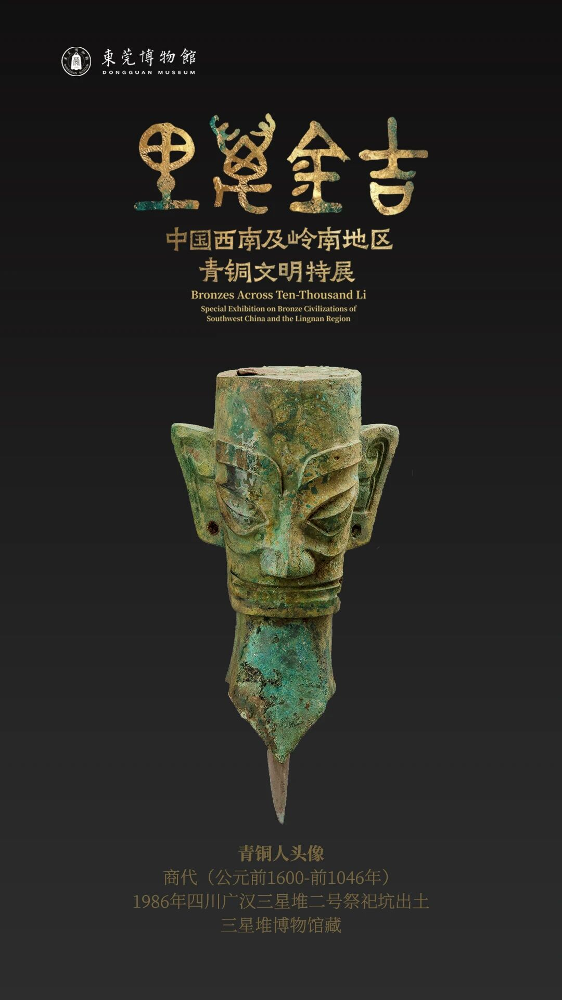

# 一眼三千年 · 三星堆祭司青铜头像



> 三星堆祭司青铜头像 · Vibe Coding 游戏互动赛道参赛作品
>
> 在线体验：https://xiangsir4088.github.io/sanxingdui-game/
> GitHub：https://github.com/xiangsir4088/sanxingdui-game

---

## 游戏介绍

《一眼三千年》是一个基于三星堆青铜头像的横版闯关游戏。玩家扮演一位时空旅人，从 3000 年前的铸铜炉膛出发，穿越祭祀仪式、长埋地下的黑暗土层、考古发掘现场，最终抵达今天的博物馆展柜。

**叙事线**：它先是一团火（铸铜）→ 被贴上青铜（祭祀）→ 被埋入地下（掩埋）→ 1986 年被重新发现（发掘）→ 走进博物馆（对视）。五关对应青铜头像的五个生命阶段，每一关的门都是通往下一段历史的通道。

### 5 关机制递进

| 关卡 | 名称 | 核心机制 | 氛围 | 终点 |
|---|---|---|---|---|
| 第一关 | 铸铜炉膛 | 火喷柱（固定节奏，从炉膛缝隙喷出） | 炉火映红的作坊，夯土台基 | 炉门（火舌舔舐） |
| 第二关 | 祭坛之夜 | 高台绕路 + 跪拜队列（从两侧涌来的跪拜者） | 星光下的祭祀仪式，条石祭坛 | **碎器终章**：按空格一件件撞断 → 燎祭 → 瘗埋 |
| 第三关 | 长埋地下 | 锈池（从地缝喷出的铜锈矿刺，非液柱） | 黑暗土层剖面，4 层土带 + 断续沉积面 | 地面裂口（深处透光） |
| 第四关 | 探方发掘 | 落石（从坑口坠落的石块）＋天色转沉、闷雷压来 | 考古工地，竖井探方，抢在七月雷雨前 | **拼合终章**：11 片残片错时飞回、逐片咬合复原 |
| 第五关 | 展柜对视 | 观众闪光灯（观众举起手机，白闪半径内扣血，高台为避难所） | 博物馆展厅，抛光石材地面 | **对视终章**：推近 → 器物升上台座 → 射灯亮 → 玻璃里浮出举着手机的那个"你" |

### 玩法

- **目标**：每关收集 4 件拾取物（第 1/2/3/5 关是「光尘」，第 4 关是「残片」），集齐后走向终点进入终章演出
- **血量**：MAXHP = 2 点，被障碍物打到后回出生点，**保留已收集的光尘**（不是本关重来）
- **难度递进**：预警时间从 1.0 秒砍到 0.5 秒，安全窗从 1.6 秒砍到 0.8 秒——反应时间逐关减半

### 操作

| 平台 | 移动 | 跳跃 | 重来 | 退出 | 静音 |
|---|---|---|---|---|---|
| 键盘 | ← → / A D | Space / ↑ / W | R | Esc / B | M |
| 手柄 | 左摇杆 / 十字键 | A | B | Start | Y |
| 触屏 | 虚拟方向键 | 虚拟跳跃键 | 自动 | 自动 | 自动 |

---

## 技术架构

### 设计约束

三星堆博物馆 Vibe Coding 赛道硬约束：**单文件 HTML，无外部依赖，断网可跑**。

| 维度 | 常见方案 | 本文方案 |
|---|---|---|
| 依赖 | React + Three.js + 音频库 ≈ 500KB | 零依赖 |
| 体积 | 3MB+（带 3D 模型和纹理） | 1230.3 KB（含所有内联素材） |
| 加载 | 需要 CDN 或服务端 | 双击 `.html` 直接玩 |
| 素材 | 外部 PNG/MP3 文件 | 全部 base64 内联 |
| 部署 | 需要 Web 服务器 | GitHub Pages 单文件 |

### 核心系统

| 系统 | 实现 |
|---|---|
| 渲染 | HTML5 Canvas 2D，vanilla JS，零框架 |
| 物理 | 固定时间步 1/120s + `guard` 防死循环；coyote time 0.12s / jump buffer 0.14s |
| 输入 | 键盘 + 触屏虚拟键 + Gamepad API + iframe 兼容 |
| 音频 | Web Audio API 全合成，零音频文件 |
| 存档 | localStorage（`sdx_progress_v1`，内部 `v:2` 带版本迁移），刷新不丢通关记录；静音状态单独持久化 |
| 碰撞 | AABB 矩形碰撞，障碍物状态机（预警 → 激活 → 安全窗） |

### 素材管线

8 张 AI 精灵 + 1 张文物抠图全部内联，断网可跑：

```
SenseNova U1.5 Lite 文生图 (PNG 2048x2048, 4~5MB)
  → PIL floodfill 抠黑底 (RGBA PNG)
  → 连通域修补封闭洞 (清除残留黑块)
  → WebP q90 压缩 (压 78%, 10~90KB)
  → base64 内联进 HTML (单文件 1225KB)

馆方文物照 (1080x1920 JPEG)
  → 色彩距离软阈值 + 正交凸包填内部洞
  → WebP q90 with alpha (148KB)
  → base64 内联（保持原像素网格，裁剪坐标零改动）
```

**关键设计**：图片优先 + 几何兜底——sprite 加载成功就用图，否则走原几何绘制，首帧/异常环境不出空白。

**零外部资源**：HTML 里没有任何 `` 或外部文件引用，所有图都是 data URI。双击 `index.html`（`file://` 协议）与线上 HTTP 访问表现完全一致。

### 代码规模

- 约 12695 行 JS / 1230.3 KB 单文件
- 7 个 Python 构建脚本（素材处理 + 截图验证 + 发布同步）
- 25+ 条踩坑记录（见 CHANGELOG）

---

## 开发历程

3 天核心开发，10 轮迭代：

| 轮次 | 时间 | 体积 | 核心改动 |
|---|---|---|---|
| 初版 | 10/24 | 72 KB | 基本框架 + 第 1 关 |
| P0.x | 10/24 | 190 KB | 存档 / 血量子系统 / 教学提示 / 触屏虚拟键 / 第 1 关节奏收紧 |
| P1.x | 10/26 | 579 KB | 5 关教学提示 / 10 处抽象剪影 → AI 高精度 sprite / 结局页金箔剥落彩蛋 |
| P2.1 | 10/27 | 688 KB | 五道时代之门 / 主题地面 / 五关各用各的终点 |
| P2.2 | 10/27 | 704 KB | 锈池迭代（4 版液柱 → 矿刺方案）/ 锈疤底座 / 程序化孔雀石纹理 |
| P2.3 | 10/27 | 713 KB | 神树真素材剪影 / 抠图封闭洞修补 / 土层碎屑层 |
| P2.9 | 10/27 | 853 KB | SenseNova 矿簇图替换 225 行程序化代码 |
| P3.x | 10/27 | 1022 KB | 渐变预烘焙 / 三档难度 / 文物配图抠图内嵌（修复 file:// 双击配图丢失） |
| P3.8~3.9 | 10/27 | 1129 KB | 五关考据复检（5 处史实错误）/ 第 5 关激光改观众闪光灯 / 放大挑刺 |
| P4.0 | 10/27 | 1174 KB | 第 2 关「碎器」终章（砸—燎—瘗）/ 第 4 关拾取物改「残片」+ 终点「拼合」 |
| P4.1 | 10/27 | 1216 KB | 选关页重做 / 介绍页时间轴 / 第 1 关「合范」/ 第 4 关「雷雨」/ 第 5 关「对视」终章 / 存档迁移·静音持久化·拖尾合并 |
| P4.2 | 10/27 | 1225 KB | 第五关可读性返工：光柱压成雾 / 爆闪改局部径向光 / 地面危险范围 + 收缩环 / 高台亮边·光池·落影 / HUD 叠印修复 |
| P4.3 | 10/27 | 1227.5 KB | 第五关第二波（第一人称验证）：玩家金色呼吸环 / 地面抬亮成石板路 / 观众手机常亮·轮廓光 / 危险圈常态可读 / 高台提示前移 x=380 |
| P4.4 | 10/27 | 1228.2 KB | 第五关危险传达重做（一眼看懂）：危险圈改红色警示圈 / 观众手机常亮暖黄光晕 / 高台绿色安全箭头 / 提示点破人光因果 |
| P4.5 | 10/27 | 1228.5 KB | 难度梯度重做（速度难度接入+预警安全窗拉大）/ 结局金面真实化（熔金滤镜降级·光斑30→10·金箔暗金质感） |
| P4.6 | 10/27 | 1228.5 KB | 第五关难度恢复：4 枚光尘改为「3 枚埋进观众闪光红圈 + 1 枚平台避难所奖励」，集满才通关 → 必须卡安全窗冲进红圈拾取 |
| P5.0 | 10/28 | 1230.3 KB | 结局页去失真：废弃 lighter 加色混合（暗部永不黑→自发光塑料感），熔金改「亮度→金箔色阶」映射，sepia/tint 全砍 |
| P4.8 | 10/28 | 1227.6 KB | 第五关还原为激光版（可跳）：5 道激光 3 中 2 低，废弃闪光灯/红圈机制 + 难度梯度回备份口径 |
| P4.7 | 10/28 | 1229.7 KB | 第五关节奏回调·可玩性修复：安全窗 1.95s→1.4s、爆闪 0.15→0.22s，修 `on×warnScale` bug 改独立 onScale，难度重配（normal 会躲挨打 0.06→0.80 次） |

### AI 协作

与 WorkBuddy 智能体结对完成，AI 起草约 95% 代码，人工全量 review + 关卡设计 + 每轮验收。

- **AI 生成素材**：8 张精灵（主祭 / 跪拜者 / 大立人 / 纵目面具 / 青铜神树 / 天空神面 / 锈贴图 / 矿簇图），SenseNova U1.5 Lite 文生图
- **人工把关**：关卡节奏拍板 / 用户反馈转译 / 素材提示词调优（每张图 2~3 轮）/ headless Chrome 截图逐像素验收
- **详细技术分享**：见 CSDN 文章《一个单文件 HTML5 Canvas 游戏，3 天从 72KB 做到 853KB：我和 AI 结对把三星堆青铜头像做成了 5 关横版闯关》

---

## 运行

双击 `index.html` 即可，无需服务器，无需联网。

```bash
# 或本地开发
open index.html

# 发布到 GitHub Pages
python github-pages/_sync.py
```

---

## 相关链接

- CHANGELOG（含 25+ 条踩坑记录）：`https://github.com/xiangsir4088/sanxingdui-game/blob/main/CHANGELOG.md`
- CSDN 技术分享：《一眼三千年》AI 结对实录专栏第二篇
- 视频分镜与提示词：`https://github.com/xiangsir4088/sanxingdui-game/blob/main/视频分镜与提示词_三星堆祭司青铜头像.md`
- 音效设计说明：`https://github.com/xiangsir4088/sanxingdui-game/blob/main/音效设计说明.md`

---

## 合规声明

铸造 / 祭祀 / 掩埋 / 对视等情节为艺术想象，非考古复原。造型依据馆方展签与展览海报的二次创作，未直接使用馆方高清素材。AI 生成素材使用商汤 SenseNova U1.5 Lite。本文仅用于技术分享，与三星堆博物馆无任何商业关联。

License：MIT
